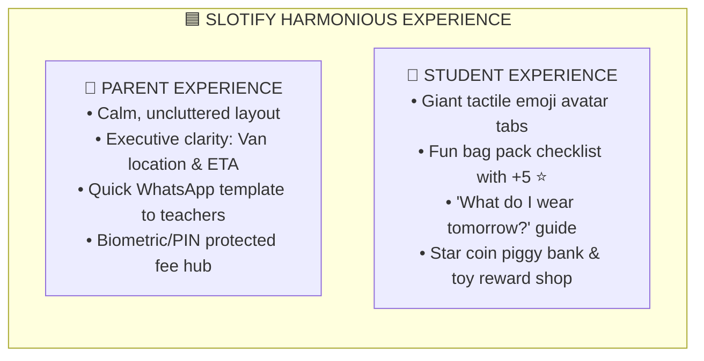

# 🎨 Slotify — Brand Identity & Visual Design System Guide
> **Role:** Senior Art Director & Lead Product Designer  
> **Brand Identity:** **Slotify** (*"Susun Waktu Anak, Tenang Sepanjang Hari" / "Slotify your day"*)  
> **Aesthetic Philosophy:** *Tactile Soft UI (Neumorphism)* + *Casual Friendly Rounded Geometry*  
> **Design Target:** Harmonious Dual-Experience for **Parents** (Calm, Trustworthy, Organized) & **Students** (Friendly, Tactile, Gamified)

---

```
┌────────────────────────────────────────────────────────────────────────────┐
│                    SLOTIFY 60 : 30 : 10 COLOR RATIO RULE                   │
├────────────────────────────────────────────────────────────────────────────┤
│                                                                            │
│   ██████████████████████████████████████   60% DOMINANT BASE               │
│   #F4F7FB (Soft Cloud Pearl)               • Background Canvas             │
│   Light Neumorphic Base Canvas             • Breathing room & visual rest  │
│                                                                            │
│   ███████████████████                      30% STRUCTURAL SECONDARY        │
│   #E8EFF8 (Neumorphic Card) / #0284C7      • Tactile Cards & Containers    │
│   Deep Slate Typography & Structural Blue  • Tab Switchers & Timetable Grid│
│                                                                            │
│   ██████                                   10% ENERGETIC ACCENT            │
│   #FF7A00 (Radiant Amber) & #10B981        • Primary CTAs ("Beg Dah Kemas")│
│   Star Gold & Action Glow                  • Star Rewards ⭐ & Active Pulse│
│                                                                            │
└────────────────────────────────────────────────────────────────────────────┘
```

---

## 🧭 1. The 60 : 30 : 10 Color Architecture

To prevent visual clutter while keeping the interface vibrant and joyful for kids, we adhere strictly to the **60:30:10 Rule**:

### 60% — Dominant Base (Canvas & Negative Space)
- **Token:** `SlotifyColors.CanvasBase` (`#F4F7FB`)
- **Dark Mode Alternative:** `SlotifyColors.CanvasBaseDark` (`#111622`)
- **Purpose:**
  - Provides a soft, glare-free pearl background.
  - Allows subtle Neumorphic dual shadows (specular white highlights and soft slate drop shadows) to achieve photorealistic depth.
  - Ensures prolonged screen time doesn't cause eye strain for parents reviewing schedules at night or kids checking their morning bags.

### 30% — Structural Secondary (Organization, Cards & Typography)
- **Tokens:**
  - `SlotifyColors.SurfaceCard` (`#E8EFF8`): Tactile card surfaces.
  - `SlotifyColors.KpmSkyBlue` (`#0284C7`): Structural headers, day navigation tabs, subject badges.
  - `SlotifyColors.TextPrimary` (`#0F172A`): Deep navy slate for high-contrast, effortless readability.
  - `SlotifyColors.TextSecondary` (`#64748B`): Cool slate for timestamps, class names, and subtitles.
- **Purpose:**
  - Structures complex Malaysian dual-session timetables into clear, digestible chunks.
  - Provides contrast boundaries between periods, school sessions, and transport steps.

### 10% — Radiant Accent (Action, Motivation & Focus)
- **Tokens:**
  - `SlotifyColors.ActionAmber` (`#FF7A00` / `#F59E0B`): Star Coins `⭐`, Active Period Pulse, Primary Buttons (*"Beg Dah Siap!"*).
  - `SlotifyColors.SuccessMint` (`#10B981`): Completed tasks, verified geofence arrival, safe transit status.
- **Purpose:**
  - Guides the child's eyes instantly to the next important task.
  - Delivers dopamine triggers through glowing star coin badges and tactile reward claims.

---

## 🧸 2. Visual Tone: "Casual, Warm & Tactile"

```
     ☀️ Top-Left Virtual Specular Glow (#FFFFFF, 90% opacity)
            ┌─────────────────────────────────────────┐
            │   [ SQUIRCLE CARD — Corner Radius 20dp ]│
            │   Surface: #E8EFF8                      │
            │   • Friendly rounded geometry           │
            │   • Soft tactile press response         │
            └─────────────────────────────────────────┘
     🌑 Bottom-Right Soft Slate Blur (#CBD5E1, 75% opacity)
```

### 2.1 Geometry & Squircles
- **No Sharp Corners:** All cards, chips, and buttons use **Squircle corner radii of `16dp` to `24dp`**.
- **Soft Touch Physics:** Interactive cards bounce gently when tapped (spring animation with damping ratio `0.75f`), making the app feel like a physical, tactile educational toy.

### 2.2 Typography System
| Level | Typeface Style | Size / Weight | Purpose |
|---|---|---|---|
| **Display / H1** | *Rounded Sans* (Nunito / Fredoka) | `26sp` Bold | Screen titles, Child nicknames, Star balance |
| **Section / H2** | *Rounded Sans* | `18sp` SemiBold | Section headings ("Buku Kena Bawa", "Laluan Abah") |
| **Slot Title** | *Inter Rounded* | `14sp` Bold | Subject names ("Bahasa Melayu", "Sains") |
| **Timestamps / Data** | *Inter* (Tabular Figures) | `12sp` Medium | Time slots ("08:00 – 11:00"), Fee amounts |
| **Micro Labels** | *Inter* | `10sp` Regular | Badges, driver names, subject room info |

---

## 🎭 3. Dual-Audience Persona Design Strategy



### 3.1 Parent Mode Highlights (Parent Dashboard)
- **High Information Density with Calm Layout:** View Adam, Aisyah, and Danial on a single synchronized timeline without cognitive overload.
- **Chained Pickup ETA:** See at a glance: *Pejabat ➔ Tadika Danial (10m) ➔ Taska Aisyah (8m) ➔ Rumah*.
- **Quick Action Teacher Hub:** 1-tap WhatsApp message generator with polite pre-filled BM templates (*"Assalam cikgu, saya bapa kepada Adam..."*).

### 3.2 Student Mode Highlights (Adam, Aisyah, Danial)
- **Bag Pack Helper Gamification:** Tapping each textbook item indents the card (`SUNKEN` tactile feedback). When all items are checked, a celebratory confetti and `+5 ⭐ Bintang` sound triggers.
- **Tomorrow's Attire Visual:** Shows an illustrated mascot wearing tomorrow's exact outfit (e.g. Wednesday Scout uniform with beret, Friday white Baju Melayu with samping).

---

## 🎨 4. KPM Subject Badge Color Harmonization

While keeping the overall screen within the 60:30:10 ratio, subject codes use dedicated **soft pastel badges** (15% opacity tint container + saturated text) so they do not compete with the primary amber accent:

```
┌──────────────┬───────────────────┬──────────────┬────────────────────────┐
│ Subject Code │ Subject Name (BM) │ Accent Color │ Soft Tint Background   │
├──────────────┼───────────────────┼──────────────┼────────────────────────┤
│ BM           │ Bahasa Melayu     │ #0284C7      │ #E0F2FE (Sky Tint)     │
│ BI           │ Bahasa Inggeris   │ #EF4444      │ #FEE2E2 (Rose Tint)    │
│ MT           │ Matematik         │ #F59E0B      │ #FEF3C7 (Amber Tint)   │
│ SN           │ Sains             │ #10B981      │ #D1FAE5 (Emerald Tint) │
│ PI / BA      │ Pend. Islam / BA  │ #0D9488      │ #CCFBF1 (Teal Tint)    │
│ SEJ          │ Sejarah           │ #EA580C      │ #FFEDD5 (Orange Tint)  │
│ RBT          │ RBT               │ #B45309      │ #FEF3C7 (Warm Tint)    │
│ KOKU         │ Unit Beruniform   │ #8B5CF6      │ #EDE9FE (Purple Tint)  │
│ REHAT        │ Waktu Rehat       │ #F97316      │ #FFEDD5 (Peach Tint)   │
└──────────────┴───────────────────┴──────────────┴────────────────────────┘
```

---

## 📱 5. App Icon & Brand Lockup Concept

```
 ┌─────────────────────────────────────────────────────────────┐
 │  SLOTIFY LAUNCHER ICON DESIGN (Android Adaptive Icon)       │
 │                                                             │
 │   ┌─────────────────────────────────────────────────────┐   │
 │   │  Outer Container: Soft Pearl Squircle (#F4F7FB)     │   │
 │   │                                                     │   │
 │   │      ☀️ Top-Left Specular Light                     │   │
 │   │     ┌────────────────────────────────────────┐      │   │
 │   │     │   🟦 SRA Morning Slot  (Sky Blue)      │      │   │
 │   │     ├────────────────────────────────────────┤      │   │
 │   │     │   🟧 Transit / Rehat   (Radiant Amber) │ 🌟   │   │
 │   │     ├────────────────────────────────────────┤      │   │
 │   │     │   🟩 SK Afternoon Slot (Emerald Mint)  │      │   │
 │   │     └────────────────────────────────────────┘      │   │
 │   │      🌑 Bottom-Right Soft Shadow                    │   │
 │   └─────────────────────────────────────────────────────┘   │
 └─────────────────────────────────────────────────────────────┘
```

- **Brand Wordmark:** **Slotify** in rounded lowercase/titlecase with an amber spark over the letter `i` (*Slotify*).
- **Secondary Tagline:** *"Susun Waktu Anak, Tenang Sepanjang Hari"*.
