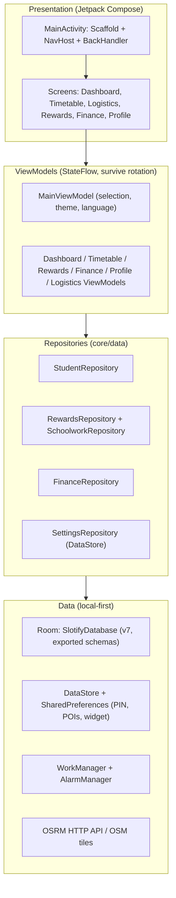
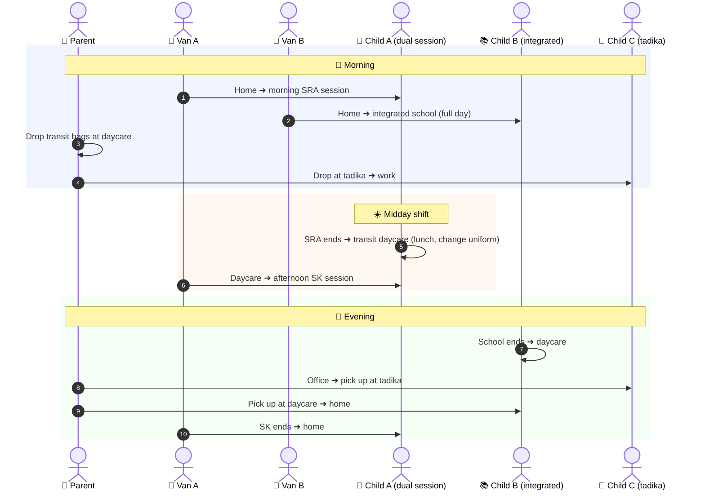
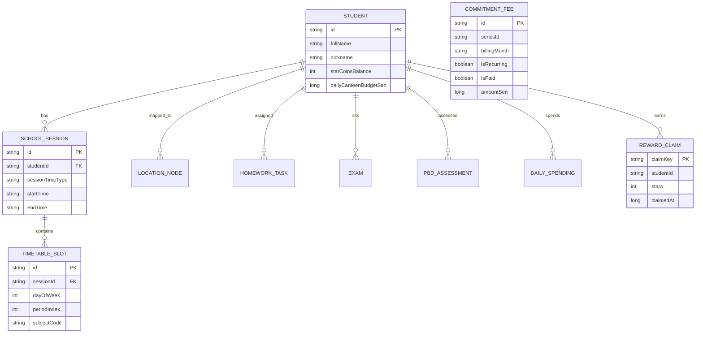

# 🇲🇾 Slotify — Master Technical & System Documentation

> **Application Name:** **Slotify**
> **Tagline:** *"Susun Waktu Anak, Tenang Sepanjang Hari"* / *"Slotify your day. Plan smarter, slot better."*
> **Platform:** Native Android (Kotlin 2.4 & Jetpack Compose, Min SDK 26, Target SDK 36, Compile SDK 37)
> **Package Name / Application ID:** `my.slotify.app`
> **Architecture:** Single-module MVVM — Compose screens ➜ feature ViewModels (`StateFlow`) ➜ repositories ➜ Room / DataStore, with Navigation Compose
> **Data Philosophy:** 🔒 Local-First, Privacy-Focused (user owns all data on-device; personal seed data never committed — see §11)
> **Map & Routing Engine:** OpenStreetMap via `osmdroid` + OSRM Driving API
> **UI Style:** Tactile Neumorphic Soft UI (Dual-Shadow Canvas Shaders + Pastel KPM Palettes)

---

## 📑 Table of Contents
1. [Executive Overview & Value Proposition](#-1-executive-overview--value-proposition)
2. [System Architecture & Tech Stack](#️-2-system-architecture--tech-stack)
3. [Tactile Neumorphic Design System](#-3-tactile-neumorphic-design-system)
4. [Family Operational Model](#-4-family-operational-model)
5. [KPM Academic & Syllabus Engine](#-5-kpm-academic--syllabus-engine)
6. [Logistics, Van Tracking & Parent Chained ETA](#️-6-logistics-van-tracking--parent-chained-eta)
7. [Gamified Star Vault & Parent PIN](#-7-gamified-star-vault--parent-pin)
8. [Canteen Allowance & Fee Management](#-8-canteen-allowance--fee-management)
9. [Room Database Schema & Migrations](#️-9-room-database-schema--migrations)
10. [Dual-Language Architecture (BM / ENG)](#-10-dual-language-architecture-bm--eng)
11. [Family Profile (Private Data Isolation)](#-11-family-profile-private-data-isolation)
12. [Build, Signing & Release](#-12-build-signing--release)
13. [Audit Findings & Fix Plan](#-13-audit-findings--fix-plan)

---

## 🎯 1. Executive Overview & Value Proposition

Malaysian primary school households with children attending **Sekolah Kebangsaan (SK)**, **Sekolah Rendah Agama (SRA/SRAI)**, and **Tadika / PASTI** face significant operational complexity daily:
- Dual school sessions (Morning SRA + Afternoon SK) with transit routines.
- Alternating weekly attire codes (KPM Official, Sports, Uniform Koku, Batik, Baju Melayu).
- Tracking multi-stream school van pickups alongside parent commuting routes.
- Daily bag packing, canteen pocket money, fee deadlines, and motivating kids through gamified rewards.

**Slotify** consolidates schedules, logistics, bag checklists, and gamified star rewards into a single tactile, child-friendly Android application.

---

## 🏛️ 2. System Architecture & Tech Stack

### 2.1 Architecture

- **Dependency wiring:** `core/di/AppContainer` (created once in `SlotifyApplication`) builds repositories; `SlotifyViewModelFactory` creates every ViewModel. Screens obtain theirs with `viewModel(factory = SlotifyViewModelFactory)`, scoped to the navigation destination.
- **Shared selection:** the selected student is persisted in DataStore and exposed by `StudentRepository.selectedStudent`, so every ViewModel observes the same child without passing it through the UI.
- **Navigation:** each tab is a `NavHost` destination stacked on Dashboard (`popUpTo(DASHBOARD)` + `saveState/restoreState`). Back closes the drawer / speed-dial first, then returns to Dashboard, then exits. Widget and notification deep links use the `EXTRA_SCREEN` extra.
- **Still in the UI layer:** map rendering, GPS, TTS and the vehicle simulation in `LogisticsMapScreen` (Android-view and sensor bound); dialogs' local form state.

### 2.2 Technical Stack Matrix
- **Build toolchain:** Gradle 9.9.1, AGP 9.5.1 with built-in Kotlin (no `kotlin-android` plugin), Kotlin/Compose compiler plugin 2.4.21, KSP 2.3.14, JDK 17. Family-profile sources are added with `kotlin.srcDir` (built-in Kotlin ignores `.kt` files in `java.srcDir`).
- **Language:** Kotlin 2.4.21 (Coroutines 1.11 & Flow)
- **UI Toolkit:** Jetpack Compose BOM 2026.09.00 (Material3 + custom neumorphic modifiers), edge-to-edge (`enableEdgeToEdge`, system-bar icons follow the in-app theme)
- **Navigation:** Navigation Compose 2.10.2; Lifecycle 2.11.0; Activity Compose 1.13.0
- **Dependency Injection:** Manual (`AppContainer` + `SlotifyViewModelFactory`)
- **Settings:** Jetpack DataStore Preferences 1.3.0 (theme, language, selected student)
- **Local Persistence:** Room 2.8.5 + SQLite (schema v7), schemas exported to `app/schemas/`
- **Background Tasks:** WorkManager 2.12.0 (widget refresh, geofence monitor) + AlarmManager (daily reminders)
- **Routing & Distance:** OSRM driving API + OkHttp 4.12
- **Map Rendering:** `osmdroid-android:6.1.20`

---

## 🎨 3. Tactile Neumorphic Design System

Neumorphism creates a realistic, extruded physical surface using dual light sources:
- **Specular Glow (Top-Left):** `#FFFFFF` with blur radius matching elevation.
- **Drop Shadow (Bottom-Right):** `#CBD5E1` with soft slate opacity.
- **Base Canvas:** `#EDF2F7` (Soft Pearl Light) / `#141820` (Dark Slate).

### 3.1 Color Palette Tokens (`SlotifyColors`)
| Token Name | Hex Code | Purpose |
|---|---|---|
| `BackgroundLight` | `#EDF2F7` | Main screen background canvas |
| `SurfaceCard` | `#EAF0F8` | Elevated tactile cards and buttons |
| `KpmBlue` | `#0284C7` | Bahasa Melayu & Primary KPM brand color |
| `ScienceGreen` | `#10B981` | Sains, safe geofence arrival, completed tasks |
| `MathAmber` | `#F59E0B` | Matematik, Waktu Rehat, due alerts |
| `IslamTeal` | `#0D9488` | Pendidikan Islam, Bahasa Arab, Jawi, PASTI |
| `EnglishRed` | `#EF4444` | Bahasa Inggeris & urgent alerts |
| `KokuPurple` | `#8B5CF6` | Unit Beruniform, Kokurikulum & Rewards |
| `VanPrimaryBlue` | `#2563EB` | Primary school-van route identifier |
| `VanSecondaryGold`| `#D97706` | Secondary school-van route identifier |
| `ParentGreen` | `#059669` | Parent evening pickup route identifier |

---

## 👨‍👩‍👧 4. Family Operational Model

The routine engine is built around **roles**, not specific people. The concrete names, schools, coordinates and times live only in the private family profile (§11).

---

## 📚 5. KPM Academic & Syllabus Engine

### 5.1 Weekly Attire Resolver
- **Monday:** Official KPM Uniform (Kemeja Putih + Seluar Biru / Baju Kurung).
- **Tuesday:** Sports T-Shirt (Baju Rumah Sukan / PJK).
- **Wednesday:** Full Kokurikulum Uniform (Pengakap, TKRS, Puteri Islam, etc.).
- **Thursday:** Koku T-Shirt / Official School Batik.
- **Friday:** Baju Melayu Putih Lengkap (Samping & Songkok) / Baju Kurung.

### 5.2 School-day convention
`TimetableSlotEntity.dayOfWeek` uses **1 = Isnin … 5 = Jumaat**. Weekend handling is centralised in `core/time/SchoolDay.kt`:
- On Saturday/Sunday there is **no "today" timetable**.
- "Next school day" from Friday, Saturday or Sunday is **Monday** (used by the bag checklist).

### 5.3 Session inversion (Year 4 ➜ Year 5)
A student may have several `SchoolSessionEntity` rows (e.g. SRA pagi + SK petang). The timetable's inversion toggle cycles the active session; a year-level change swaps which session runs in the morning.

### 5.4 ICS import
`IcsParser` converts a school-issued `.ics` export into weekly `TimetableSlotEntity` rows (de-duplicated by day/start/subject). ICS files are supplied by the family profile from `assets/` so a specific class timetable is not committed.

---

## 🗺️ 6. Logistics, Van Tracking & Parent Chained ETA

- **Map:** osmdroid with OpenStreetMap tiles; © OpenStreetMap contributors attribution is shown on the map.
- **Routing:** OSRM driving API. On network failure the UI shows an explicit *"Anggaran luar talian"* (offline estimate) state — it never presents a fabricated route as live.
- **Routes:** three route slots — `PARENT_PICKUP`, `VAN_PRIMARY`, `VAN_SECONDARY`. Their labels, waypoints (POI ids), driver contacts and step notes come from the family profile.
- **Geofencing:** `GeofenceManager` evaluates distance to each POI with a per-target state machine (`NONE → APPROACHING → ENTERED → INSIDE → EXITED`), separate cooldowns per event type and persisted state. Background evaluation only runs if `ACCESS_BACKGROUND_LOCATION` has been granted.
- **Usage policies:** the public OSRM demo server and OSM tile servers are rate-limited community services. Bulk offline tile download is **not** offered (it violates the OSM tile usage policy); tiles are cached passively as they are viewed. A self-hosted OSRM instance is recommended before any wide distribution.

---

## 🌟 7. Gamified Star Vault & Parent PIN

### 7.1 Star earning — every award is idempotent
All star awards go through `StarRewards.claimOnce(dao, studentId, claimKey, stars)`, which inserts a row into `reward_claims` and credits the balance **in one transaction**. A second claim with the same key is a no-op, so toggling a checkbox or reopening a dialog can never mint extra stars.

| Action | Stars | Claim key (one-time scope) |
|---|---|---|
| Complete a homework task | task's `rewardStars` (5–10) | `homework:<taskId>` (once per task, ever) |
| Pack school bag (dashboard button or checklist) | `+5` | `bag:<studentId>:<date>` (once per day) |
| Daily mystery chest | `+15` | `chest:<studentId>:<date>` (once per day) |
| Convert RM 10 canteen savings | `+10` | `savings:<studentId>:<n>` — also deducts RM 10 from Tabung Maya |
| Record a PBD result TP5 / TP6 | `+15` | `pbd:<studentId>:<subject>:<period>` |
| Record a PBD result TP1–TP4 | `+5` | `pbd:<studentId>:<subject>:<period>` |

### 7.2 Redemption
Redemption uses a single conditional SQL update (`… SET starCoinsBalance = starCoinsBalance - :cost WHERE id = :id AND starCoinsBalance >= :cost`). The success dialog is only shown when that update affected a row.

### 7.3 Parent PIN (`core/security/PinManager.kt`)
- **No default PIN.** On first use the parent is asked to create a 4–6 digit PIN (entered twice).
- Stored as **PBKDF2-HMAC-SHA256** with a random 16-byte salt.
- Failed attempts and lockout deadline are **persisted**, so closing the dialog does not reset them. Lockout escalates: 3 failures ➜ 30 s, 6 ➜ 2 min, 9 ➜ 10 min, then 30 min per further 3 failures.
- The PIN can be changed from the Reward Vault (requires the current PIN).

### 7.4 Reward Catalog (defaults)
- **1 Hour Roblox / iPad:** `50 ⭐`
- **Buy Toy / Hot Wheels:** `200 ⭐`
- **Ice Cream Outing:** `30 ⭐`
- **Stay Up 30 Mins Later (Saturday Night):** `20 ⭐`

---

## 💰 8. Canteen Allowance & Fee Management

### 8.0 Money representation
All amounts are stored as whole **sen** in `Long` columns (`dailyCanteenBudgetSen`, `amountSen`, `spentSen`; RM 1.00 = 100). Use `core/model/Money` to format (`Money.format(1250)` → `"RM 12.50"`) and parse user input. This removes floating-point drift from repeated ±RM 0.50 adjustments.

### 8.1 Daily canteen flow
- Each student has a `dailyCanteenBudgetSen`. Spending is stored per student per day in `daily_spending`.
- **Tabung Maya** = Σ max(0, budget − spent) over all recorded days − RM 10 × (number of savings conversions). There is no synthetic starting balance.

### 8.2 Recurring fees
- A fee row belongs to one `billingMonth` (`yyyy-MM`). Its `seriesId` links the same fee across months and `isRecurring` marks monthly fees.
- When a month is opened for the first time, `FeeRepository.ensureMonth()` copies every recurring fee from the most recent earlier month into the new month as **unpaid** (`id = "<seriesId>_<yyyy-MM>"`).
- Seed fees are created for the **current** month at first launch (never a hard-coded month).

---

## 🗄️ 9. Room Database Schema & Migrations

- **Current version:** 7. Schemas are exported to `app/schemas/my.slotify.app.core.database.SlotifyDatabase/` and must be committed.
- **Migrations:**
  - `MIGRATION_5_6` adds `reward_claims` and the fee `seriesId` / `isRecurring` columns.
  - `MIGRATION_6_7` converts money to sen by rebuilding `students`, `commitment_fees` and `daily_spending` (create-copy-drop-rename). It compares row counts of every table before/after and runs `PRAGMA foreign_key_check`; any mismatch throws, which rolls the upgrade transaction back with data intact.
  - Destructive fallback is only allowed from pre-release versions 1–4.
  - `SlotifyMigrationTest` (instrumented) covers both migrations: `./gradlew connectedDebugAndroidTest`.
- **Never use `OnConflictStrategy.REPLACE` on parent tables** (`students`, `school_sessions`): SQLite implements REPLACE as delete + insert, which fires `ON DELETE CASCADE` and wipes children. Parent writes use `@Upsert`; seeding uses `INSERT OR IGNORE`.

---

## 🌐 10. Dual-Language Architecture (BM / ENG)

- **Single system:** all Compose UI text comes from `SlotifyStrings.kt` (`strings.*` via `LocalAppLanguage`), so the in-app BM/EN switch applies everywhere and recomposes without restart. Parameterised text uses lambdas (e.g. `strings.pinAttemptsLeft(2)`). Inside lambdas/coroutines capture `val str = strings` first, because `strings` is a `@Composable` getter.
- **Android resources:** `res/values/strings.xml` now holds only text rendered outside Compose — the launcher label and home-screen widget labels. `values-en/` was removed.
- **Checks:** `SlotifyStringsTest` fails if any BM or EN entry is blank.
- **Remaining work (P5-3):** ~140 BM literals are still inline in screen code (largest: Logistics, Dashboard, Finance). Move them into `SlotifyStrings` when touching each screen.

---

## 🔐 11. Family Profile (Private Data Isolation)

All family-specific data — children's names, schools, classes, home/office coordinates, driver contacts, routines, fee templates, ICS timetables — is provided by a single object, `FamilyProfileData`, implementing `core/profile/FamilyProfile`.

| Source directory | Committed? | Used when |
|---|---|---|
| `app/family-profile/demo/` | ✅ Yes — fictional family | `app/family-profile/private/` does not exist (fresh clones, CI) |
| `app/family-profile/private/` | ❌ No — `.gitignore`d | Present on the family's own machine |

`app/build.gradle.kts` adds exactly one of these directories to the `main` source set (`java/` and `assets/`). Pass `-PslotifyProfile=demo` to force the demo profile even when a private one exists (useful to check the committed build). `FamilyProfileConsistencyTest` validates whichever profile is compiled in. To build with your own family:
1. Copy `app/family-profile/demo/` to `app/family-profile/private/`.
2. Edit `private/java/my/slotify/app/core/profile/FamilyProfileData.kt` and place any ICS files in `private/assets/`.
3. **Back the private folder up separately** — it is intentionally not in git.

Stable IDs (e.g. `student-…`, `session-…`) must not change between releases, because existing installs reference them.

---

## 📦 12. Build, Signing & Release

- **Signing:** release signing reads `keystore.properties` in the repo root (git-ignored; keys `storeFile`, `storePassword`, `keyAlias`, `keyPassword`) or the environment variables `SLOTIFY_KEYSTORE_FILE`, `SLOTIFY_KEYSTORE_PASSWORD`, `SLOTIFY_KEY_ALIAS`, `SLOTIFY_KEY_PASSWORD`. There are **no password fallbacks** in the build script; without credentials the release build is left **unsigned** (`app-release-unsigned.apk`), so nothing publishable is produced by accident and CI needs no keystore.
- **R8:** enabled for release. Libraries ship their own consumer rules, so `proguard-rules.pro` only keeps app-specific reflection targets.
- **Checks:** `./gradlew testDebugUnitTest lintDebug` must pass before tagging a release.

---

## 🩺 13. Audit Findings & Fix Plan

Audit date: **2026-11-14** (v1.1.0, DB v5). Baseline: 31/31 unit tests passing; `lintDebug` failing with 5 errors / 111 warnings.

Status legend: ✅ Done · 🔄 In progress · ⏳ Planned

### P1 — Security & privacy (critical)
| ID | Finding | Fix | Status |
|---|---|---|:---:|
| P1-1 | Children's names, schools, home/office coordinates & address, car plate, phone numbers and daily location routine hard-coded in source (and already on `origin/main`) | Move all family data into `FamilyProfile`; commit a fictional demo profile; git-ignore the private profile; purge history before the next push | ✅ |
| P1-2 | Keystore password fallback `"slotify2026"` committed in `app/build.gradle.kts` | Read credentials from `keystore.properties` / env only | ✅ |
| P1-3 | PIN defaults to `1234`, `setPin()` never called, lockout held in `remember`, unsalted SHA-256 | First-run PIN setup, PBKDF2 + salt, persisted escalating lockout, change-PIN flow | ✅ |
| P1-4 | Unlimited star farming (homework re-toggle, daily chest, bag pack ×2, savings conversion never deducts) | `reward_claims` table + `StarRewards.claimOnce`; savings conversions deduct from Tabung | ✅ |
| P1-5 | Redemption success shown even when balance check fails | Atomic conditional SQL spend; show success only on success | ✅ |
| P1-6 | Widget receiver exported with a custom action any app can send | Explicit-component broadcast only; drop custom action from the intent filter | ✅ |

### P2 — Data safety
| ID | Finding | Fix | Status |
|---|---|---|:---:|
| P2-1 | `REPLACE` on `students` / `school_sessions` cascade-deletes children | `@Upsert` for parents; `INSERT OR IGNORE` for seeding | ✅ |
| P2-2 | `fallbackToDestructiveMigration()` + `exportSchema = false` | Export schemas, add `MIGRATION_5_6`, destructive only from v1–4 | ✅ |
| P2-3 | Seeder runs twice concurrently and re-`REPLACE`s homework on every launch (resets completion) | One seeding path, versioned, insert-or-ignore | ✅ |
| P2-4 | Lint errors: `MissingPermission` ×3 (notifications), `RemoteViewLayout` ×2 (widget `<View>`) | Permission checks before `notify`; widget-safe views | ✅ |

### P3 — Correctness
| ID | Finding | Fix | Status |
|---|---|---|:---:|
| P3-1 | Bag checklist built from **today's** slots | Pass next-school-day slots | ✅ |
| P3-2 | Saturday/Sunday mapped to Monday (dashboard, timetable, ICS, widget) | `SchoolDay` helper; explicit weekend handling | ✅ |
| P3-3 | Timetable "live" tracker uses a fake 08:15 clock | Real clock ticking each minute | ✅ |
| P3-4 | Fees seeded for `"2026-09"` only; monthly fees never roll over | `seriesId` / `isRecurring` + `FeeRepository.ensureMonth()` | ✅ |
| P3-5 | Fake `RM 25.00` starting savings | Removed | ✅ |
| P3-6 | "Rekod TP" button never shows its dialog | Wire `AddPbdAssessmentDialog` | ✅ |
| P3-7 | Exam dates parsed with device locale (`Okt` fails on EN devices) | Parse with `ms-MY` then English | ✅ |
| P3-8 | Geofence: shared cooldown suppresses "arrived"; exit fires "approaching"; state lost on process death | Per-event cooldown, exit handling, persisted state | ✅ |
| P3-9 | Background geofence / widget GPS without background-location permission | Skip location work unless permission granted; schedule-based fallback | ✅ |
| P3-10 | OSRM failure returns a fabricated route labelled "OSRM Live" | Return failure; show explicit offline-estimate state | ✅ |
| P3-11 | Van simulation fires every proximity alert at start | Alerts driven by remaining route distance; labelled as simulation | ✅ |
| P3-12 | `MapView` never receives lifecycle callbacks / `onDetach` (leaks) | Lifecycle observer + `onRelease` | ✅ |
| P3-13 | Location request asks only `FINE` (ignored on Android 12+); stale permission state | Request `FINE` + `COARSE`; re-evaluate on resume | ✅ |
| P3-14 | Alarm notifications hard-code child names; alarms lost after reboot | Build content from DB; `BOOT_COMPLETED` re-scheduler | ✅ |
| P3-15 | Selected student overwritten by stale async reloads | Track selected **id**, derive entity from the students Flow | ✅ |
| P3-16 | Bulk offline tile download violates OSM policy (and is blocked by osmdroid for OSM tiles) | Remove bulk download; rely on passive tile cache; add OSM attribution | ✅ |

### P4 — Architecture (next phase)
| ID | Finding | Fix | Status |
|---|---|---|:---:|
| P4-1 | No ViewModels; DAO and business logic in composables; 1,000–2,700-line files | Feature ViewModels + repositories exposing `StateFlow` | ✅ |
| P4-2 | Navigation Compose declared but unused; Back always exits | `NavHost` + `BackHandler` for overlays | ✅ |
| P4-3 | Logistics waypoint resolution duplicated 3×; overlays rebuilt every recomposition | Single route resolver; diff overlays | ✅ |
| P4-4 | Money stored as `Double` | Store sen as `Long` (migration) | ✅ |
| P4-5 | Theme / language not persisted | DataStore-backed settings | ✅ |

### P5 — Quality
| ID | Finding | Fix | Status |
|---|---|---|:---:|
| P5-1 | Unit tests assert re-implemented copies of logic, not production code | Extract pure functions and test them; add Room migration test | ✅ |
| P5-2 | ProGuard keeps all of Compose/osmdroid; `org.json` duplicated as a runtime dependency | Trim keep rules; `org.json` → `testImplementation` | ✅ |
| P5-3 | Two localisation systems + hundreds of hard-coded BM strings | Consolidate on one system | 🔄 |
| P5-4 | Touch targets < 48 dp, 7–9 sp text, missing toggle semantics | Accessibility pass | ✅ |
| P5-5 | No CI, outdated dependencies, README version badge stale | GitHub Actions running tests + lint; dependency bump | ✅ |

### Progress log
**2026-11-14 — P1, P2, P3 implemented.** Verified with `./gradlew testDebugUnitTest lintDebug` (private profile) and `./gradlew -PslotifyProfile=demo testDebugUnitTest assembleRelease`:
- Unit tests: **49/49 passing** (was 31). New suites test production code: `PinHasherTest`, `SchoolTimeTest` (school days, exam dates, ICS), `FinanceTabungTest` (Tabung balance, fee rollover, reward keys), `GeofenceManagerTest` (state machine), `OsrmRoutingServiceTest` (parsing, failure → null), `FamilyProfileConsistencyTest` (profile integrity).
- Lint: **0 errors** (was 5); 99 warnings remain (typos, unused resources, dependency versions).
- Release (R8) APK builds: ~2.4 MB with the trimmed keep rules.
- `SlotifyMigrationTest` (Room 5 → 6) compiles but needs a device: `./gradlew connectedDebugAndroidTest`.

Still open:
- **P1-1:** history rewritten locally on 2026-11-14 with `git filter-repo` (names, places, coordinates, phone/MyKid numbers replaced in every revision and commit message; ICS timetables, screenshots and UI dumps removed). Force-pushed to GitHub on 2026-11-14 (`main` + tags). If the repo was ever public, request a cache purge from GitHub Support; old clones must be re-cloned.
- **P3-12 follow-up:** the map still lives inside a `LazyColumn` item; overlays are now released correctly, but moving it out is part of P4-3.
- **P3-9 follow-up:** background location is not requested; geofence/widget GPS stays off until a deliberate opt-in flow is built.

**2026-11-14 — P4 implemented.** Verified with `./gradlew testDebugUnitTest compileDebugAndroidTestKotlin lintDebug` (private) and `./gradlew -PslotifyProfile=demo testDebugUnitTest assembleRelease`:
- Unit tests: **55/55 passing** (adds `MoneyTest`; finance tests now in sen). Lint: **0 errors**.
- P4-1: ViewModels for every screen; repositories in `core/data`; screens no longer receive the DAO.
- P4-2: `NavHost` with a Dashboard-rooted back stack; `BackHandler` for drawer and speed-dial.
- P4-3: single `resolveRouteWaypoints`; OSRM routing and POIs moved to `LogisticsViewModel` (stale requests cancelled); the map is outside the `LazyColumn`; overlays are rebuilt only when their inputs change and simulation ticks move just the vehicle marker.
- P4-4: money in sen + `MIGRATION_6_7` (instrumented test written; needs a device).
- P4-5: theme, language and selected student persisted with DataStore.

Remaining follow-ups: the Focus timer is still an in-screen overlay rather than a `Dialog`; screens are still long files (split into smaller composables opportunistically).

**2026-11-14 — P5 implemented (partially).** Verified with `./gradlew testDebugUnitTest lintDebug` (private) and `./gradlew -PslotifyProfile=demo testDebugUnitTest lintDebug assembleRelease`:
- Unit tests: **57/57 passing** (adds `SlotifyStringsTest`). Lint: **0 errors, 17 warnings** (was 93): the remaining warnings are dependency/target-SDK versions.
- P5-1: tests exercise production code (pure helpers, migrations, ViewModel state classes).
- P5-3: one localisation system; shell, PIN, reward, bag-checklist and dashboard section strings migrated with English translations. ~140 inline literals remain.
- P5-4: icon buttons and map controls ≥ 48 dp; Compose text ≥ 10 sp, widget text ≥ 11 sp; homework and bag items use `toggleable(role = Checkbox)`; PIN dots announce digit count; current prayer time exposes a state description; MapView touch listener reports clicks.
- P5-5: GitHub Actions (`.github/workflows/android.yml`) runs tests, lint and a release build on every push/PR (demo profile); `gradlew` marked executable; README badge/architecture corrected; lint `Typos` disabled (Malay UI copy); backup rules added for Android 11- and 12+.
- **Dependency upgrade deferred** (done below): the current AndroidX releases require AGP 8.9–9.1, compileSdk 36–37 and Kotlin 2.2, so the whole toolchain has to move together.

**2026-11-14 — P5-5 toolchain upgrade.** Verified with `./gradlew testDebugUnitTest compileDebugAndroidTestKotlin lintDebug` (private) and `./gradlew -PslotifyProfile=demo testDebugUnitTest lintDebug assembleRelease`:
- Unit tests: **57/57 passing**. Lint: **0 errors**; warnings are now mostly the new `UseKtx` style hints (47), plus `OldTargetApi` (target 36 < compile 37, deliberate) and OkHttp 5 being available.
- Gradle 8.x ➜ 9.9.1, AGP 8.7 ➜ 9.5.1 (built-in Kotlin; `kotlin-android` plugin removed, `kotlinOptions` ➜ `kotlin { compilerOptions }`), Kotlin 2.0.21 ➜ 2.4.21, KSP 2.3.14, compileSdk 37 / targetSdk 36; AndroidX libraries per §2.2.
- targetSdk 36 forces edge-to-edge: `enableEdgeToEdge()` with theme-aware bar icons, top bar pads for the status bar; `Scaffold` already pads content for the navigation bar.
- Deprecations fixed: `LocalLifecycleOwner` (now `androidx.lifecycle.compose`), `Locale("ms","MY")` ➜ `Locale.forLanguageTag`, AutoMirrored volume icons, `fallbackToDestructiveMigrationFrom(dropAllTables = true, …)`.
- Release build now shrinks resources; Google Fonts cert arrays renamed to `slotify_gms_fonts_certs*` so they no longer override the font library's private resources.
- Not upgraded: OkHttp 4.12 ➜ 5.x (major version; do separately). `TabRow` ➜ `PrimaryTabRow` and `asFrameworkPaint` deprecations remain (warnings only).
- **Before installing on the family phone:** run `./gradlew connectedDebugAndroidTest` (Room migration tests 5➜6, 6➜7) and smoke-test status-bar/navigation-bar overlap, exact-alarm reminders and notifications on an Android 15/16 device.

### Execution order
1. **P1 + P2** — privacy, security and data-loss fixes (blocking any further push).
2. **P3** — correctness bugs.
3. **P4** — architecture refactor, feature by feature (Rewards ➜ Finance ➜ Dashboard ➜ Timetable ➜ Logistics).
4. **P5** — quality and tooling.

### History purge (P1-1, manual step)
Personal data already exists in pushed commits. After the code fix is committed, rewrite history (e.g. `git filter-repo` with a replace-text file covering names, coordinates and phone numbers), force-push, and ask GitHub support to purge cached views if the repository was ever public. Rotate the release keystore if its password was ever used for a real key.
