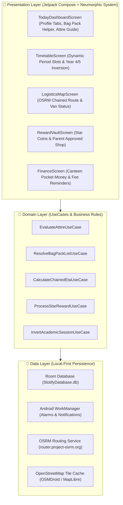
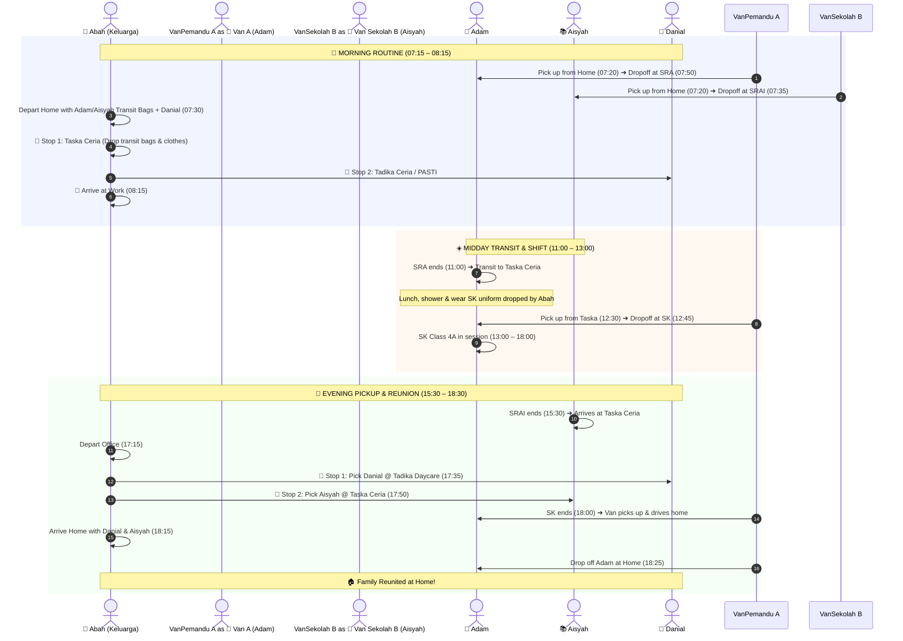
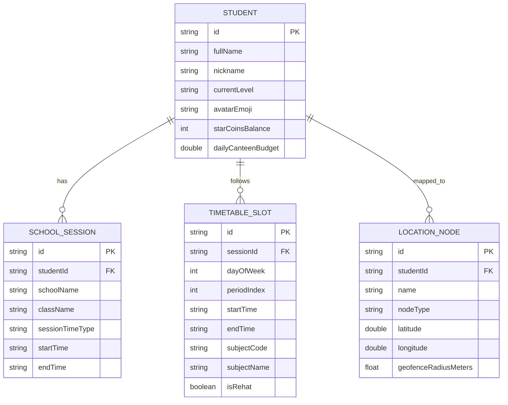

# 🇲🇾 Slotify — Master Technical & System Documentation

> **Application Name:** **Slotify**  
> **Tagline:** *"Susun Waktu Anak, Tenang Sepanjang Hari"* / *"Slotify your day. Plan smarter, slot better."*  
> **Platform:** Native Android (Kotlin 2.0+ & Jetpack Compose, Min SDK 26, Target SDK 35)  
> **Package Name / Application ID:** `my.slotify.app`  
> **Architecture Pattern:** MVI (Model-View-Intent) + Clean Architecture (Presentation, Domain, Data)  
> **Data Philosophy:** 🔒 Local-First, Privacy-Focused (User owns all data on-device)  
> **Map & Routing Engine:** OpenStreetMap (MapLibre Native Android + OSRM Driving API — 100% Free)  
> **UI Style:** Tactile Neumorphic Soft UI (Dual-Shadow Canvas Shaders + Pastel KPM Palettes)

---

## 📑 Table of Contents
1. [[#1. Executive Overview & Value Proposition]]
2. [[#2. System Architecture & Tech Stack]]
3. [[#3. Tactile Neumorphic Design System]]
4. [[#4. Real-World Family Operational Matrix]]
5. [[#5. KPM Academic & Syllabus Engine]]
6. [[#6. Logistics, Van Tracking & Parent Chained ETA]]
7. [[#7. Gamified Star Vault & Academic Evaluation]]
8. [[#8. Canteen Allowance & Fee Management]]
9. [[#9. Room Database Relational Schema]]
10. [[#10. Dual-Language Architecture (BM / ENG)]]

---

## 🎯 1. Executive Overview & Value Proposition

Malaysian primary school households with children attending **Sekolah Kebangsaan (SK)**, **Sekolah Rendah Agama (SRA/SRAI)**, and **Tadika / PASTI** face significant operational complexity daily:
- Dual school sessions (Morning SRA + Afternoon SK) with transit routines.
- Alternating weekly attire codes (KPM Official, Sports, Uniform Koku, Batik, Baju Melayu).
- Tracking multi-stream school van pickups alongside parent commuting routes.
- Daily bag packing, canteen pocket money, fee deadlines, and motivating kids through gamified rewards.

**Slotify** resolves this by consolidating all schedules, logistics, bag checklists, and gamified star rewards into a single tactile, child-friendly Android application.

---

## 🏛️ 2. System Architecture & Tech Stack

### Technical Stack Matrix
- **Language:** Kotlin 2.0.21 (Coroutines & StateFlow)
- **UI Toolkit:** Jetpack Compose (Material3 + Custom Neumorphic Canvas Modifiers)
- **Dependency Injection:** Hilt / Dagger (or Manual Constructor Injection for core modules)
- **Local Persistence:** Room Database 2.6.1 + SQLite
- **Background Tasks:** AndroidX WorkManager 2.10.0
- **Routing & Distance:** OSRM (Open Source Routing Machine) Driving Engine + OkHttp
- **Map Rendering:** OpenStreetMap (`osmdroid-android:6.1.20` / MapLibre Native)

---

## 🎨 3. Tactile Neumorphic Design System

Neumorphism creates a realistic, extruded physical surface using dual light sources:
- **Specular Glow (Top-Left):** `#FFFFFF` with blur radius matching elevation.
- **Drop Shadow (Bottom-Right):** `#CBD5E1` with soft slate opacity.
- **Base Canvas:** `#EDF2F7` (Soft Pearl Light) / `#141820` (Dark Slate).

### 3.1 Color Palette Tokens (`SlotifyColors`)
| Token Name | Hex Code | Purpose |
|---|---|---|
| `BackgroundLight` | `#EDF2F7` | Main screen background canvas |
| `SurfaceCard` | `#EAF0F8` | Elevated tactile cards and buttons |
| `KpmBlue` | `#0284C7` | Bahasa Melayu & Primary KPM brand color |
| `ScienceGreen` | `#10B981` | Sains, safe geofence arrival, completed tasks |
| `MathAmber` | `#F59E0B` | Matematik, Waktu Rehat, due alerts |
| `IslamTeal` | `#0D9488` | Pendidikan Islam, Bahasa Arab, Jawi, PASTI |
| `EnglishRed` | `#EF4444` | Bahasa Inggeris & urgent alerts |
| `KokuPurple` | `#8B5CF6` | Unit Beruniform, Kokurikulum & Rewards |
| `VanPrimaryBlue` | `#2563EB` | Van Sekolah A identifier |
| `VanSecondaryGold`| `#D97706` | Van Sekolah B identifier |
| `ParentGreen` | `#059669` | Keluarga's evening pickup route identifier |

---

## 👨‍👩‍👧 4. Real-World Family Operational Matrix

---

## 📚 5. KPM Academic & Syllabus Engine

### 5.1 Weekly Attire Resolver
- **Monday:** Official KPM Uniform (Kemeja Putih + Seluar Biru / Baju Kurung).
- **Tuesday:** Sports T-Shirt (Baju Rumah Sukan / PJK).
- **Wednesday:** Full Kokurikulum Uniform (Pengakap, TKRS, Puteri Islam, etc.).
- **Thursday:** Koku T-Shirt / Official School Batik.
- **Friday:** Baju Melayu Putih Lengkap (Samping & Songkok) / Baju Kurung.

### 5.2 Dynamic Period Slots & Year 4 vs Year 5 Inversion
The app features an **Academic Session Inversion Toggle**:
- **Year 4:** Morning SRA (08:00–11:00) + Afternoon SK (13:00–18:00).
- **Year 5 (Next Year):** Morning SK (07:30–13:00) + Afternoon SRA (14:00–17:00).
- **Aisyah (SRAI):** Combined single session (07:30–15:30).

---

## 🗺️ 6. Logistics, Van Tracking & Parent Chained ETA

Slotify uses the **Open Source Routing Machine (OSRM)** to calculate real driving distance and duration without incurring Google Maps API fees:

### 6.1 Parent Chained Pickup Route:
$$\text{Office} \xrightarrow{\text{Leg 1 (10 min)}} \text{Tadika Danial} \xrightarrow{\text{Leg 2 (8 min)}} \text{Taska Aisyah} \xrightarrow{\text{Leg 3 (10 min)}} \text{Home}$$
- **Total Trip:** $\approx 14.5\text{ km}$, $\approx 28\text{ minutes}$.

---

## 🌟 7. Gamified Star Vault & Academic Evaluation

### 7.1 Star Points Earning Matrix
| Action / Milestone | Points Delta | Trigger |
|---|---|---|
| Complete daily homework per subject | `+10 ⭐` | Checked off with photo attachment |
| Pack school bag before 9:00 PM | `+5 ⭐` | "Beg Dah Siap" button tapped |
| PBD Assessment: Achieved TP5 | `+50 ⭐` | Parent records PBD result |
| PBD Assessment: Achieved TP6 | `+100 ⭐` | Parent records PBD result |
| UASA: Achieved Grade A | `+100 ⭐` | Parent records UASA grade |
| Unspent daily canteen money saved | `+2 ⭐ / RM1` | Recorded in Canteen Ledger |

### 7.2 Reward Catalog
- **1 Hour Roblox / iPad:** `50 ⭐` (Parent PIN Approval required)
- **Buy Toy / Hot Wheels:** `200 ⭐`
- **Ice Cream Outing:** `30 ⭐`
- **Stay Up 30 Mins Later (Saturday Night):** `20 ⭐`

---

## 💰 8. Canteen Allowance & Fee Management

### 8.1 Daily Canteen Flow
- **Adam:** RM 5.00 / day budget
- **Aisyah:** RM 4.00 / day budget
- **Danial:** RM 0.00 (Meals provided at Daycare)
- Unspent balance automatically deposits into the digital Piggy Bank with star reward conversion.

### 8.2 Fee Reminder Schedule
- **Van Sekolah A:** RM 100.00 / month (1st of month)
- **Taska Ceria Transit:** RM 500.00 / month (28th of month)
- **Tadika & Daycare Danial:** RM 450.00 / month (1st of month)
- **Yuran PIBG SK:** RM 50.00 (Annual - April)

---

## 🗄️ 9. Room Database Relational Schema

---

## 🌐 10. Dual-Language Architecture (BM / ENG)

- **Default Locale (`res/values/strings.xml`):** Bahasa Melayu (Standard KPM vocabulary).
- **Secondary Locale (`res/values-en/strings.xml`):** English.
- Real-time language switching without app restart via Compose local composition providers.
