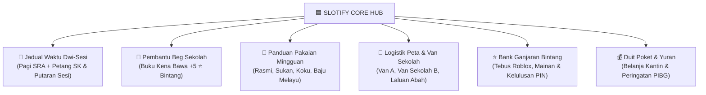

# 🟦 Slotify — Aplikasi Pengurusan Waktu & Logistik Persekolahan Anak Malaysia

<div align="center">

**"Susun Waktu Anak, Tenang Sepanjang Hari."**  
*“Slotify your day. Plan smarter, slot better.”*

[-3DDC84.svg?logo=android&logoColor=white)](https://developer.android.com/)
[](https://kotlinlang.org/)
[](https://developer.android.com/jetpack/compose)
[-F43F5E.svg)](https://developer.android.com/training/data-storage/room)
[-7EBC6F.svg?logo=openstreetmap&logoColor=white)](https://www.openstreetmap.org/)
[]()
[]() [](https://github.com/manaphassan/Slotify/actions/workflows/android.yml)

</div>

---

## 📖 Pengenalan (Overview)

**Slotify** ialah aplikasi mudah alih Android Native berasaskan reka bentuk **tenang bertema Bordeaux** (kad utama + kad status jadual) yang direka khas untuk memudahkan urusan harian ibu bapa serta murid sekolah rendah di Malaysia (**Sekolah Kebangsaan - SK**, **Sekolah Rendah Agama - SRA/SRAI**, dan **Tadika / PASTI**).

Aplikasi ini bertindak sebagai **Pusat Logistik & Waktu Sehenti Keluarga**, menyelesaikan kekusutan harian seperti dwi-sesi pagi/petang, senarai semak beg sekolah, panduan baju seragam mingguan, pengesanan dua aliran van sekolah, serta pemupukan motivasi anak melalui tabung ganjaran bintang.

---

## 🎨 Seni Reka & Peraturan Warna 60 : 30 : 10

Slotify dibina dengan mematuhi prinsip reka bentuk visual profesional **60 : 30 : 10** bagi mewujudkan antaramuka yang **santai (*casual*), mesra (*friendly*), dan taktil** untuk ibu bapa dan murid:

```
┌────────────────────────────────────────────────────────────────────────────┐
│                    SLOTIFY 60 : 30 : 10 COLOR ARCHITECTURE                 │
├────────────────────────────────────────────────────────────────────────────┤
│                                                                            │
│   ██████████████████████████████████████   60% KANVAS UTAMA (DOMINANT)     │
│   #F8F6F7 (Warm Off-White)                 • Kanvas Latar & Ruang Rehat    │
│   Minimal Flat Base Canvas                 • Menghilangkan keletihan mata  │
│                                                                            │
│   ███████████████████                      30% STRUKTUR KAD & TEKS         │
│   #FFFFFF (Kad Putih) / #9A1F3F            • Kad Bergaris, Bar Navigasi    │
│   Deep Navy Slate & Biru Struktur KPM      • Tipografi Jelas & Grid Jadual │
│                                                                            │
│   ██████                                   10% AKSEN TINDAKAN & BINTANG    │
│   #FF7A00 (Radiant Tangerine) & #10B981    • Butang Tindakan ("Beg Siap")  │
│   Star Gold ⭐ & Animasi Denyutan Sesi     • Ganjaran Dopamin & Motivasi   │
│                                                                            │
└────────────────────────────────────────────────────────────────────────────┘
```

- **Geometri Squircle (Sudut `18dp – 24dp`):** Tiada bucu tajam yang kaku; mesra sentuhan kanak-kanak.
- **Fizik Sentuhan Pegas (*Spring Haptics*):** Butang memampat ke dalam (`SUNKEN`) dengan keanjalan pegas lembut apabila ditekan.
- **Harmonisasi Subjek KPM:** Kod subjek (`BM`, `MT`, `SN`, `PI`, `BA`, `SEJ`) menggunakan bekas pastel lembut (*15% tint opacity*) agar harmoni dengan aksen utama.

---

## ✨ Ciri-Ciri Utama (Core Features)



### 1. 📅 Jadual Waktu Dwi-Sesi & Putaran Sesi (Sesi Pagi / Petang)
- Menyokong jadual persekolahan dwi-sesi serentak: **Sesi Pagi (SRA)** dan **Sesi Petang (SK)**, serta **Sesi Penuh Integrasi (SRAI)** dan **Tadika / PASTI**.
- **Enjin Pertukaran Sesi Automatik:** 1-ketikan untuk menukar giliran sesi apabila anak naik ke tahun baharu (cth: Darjah 4 [SRA Pagi / SK Petang] ➜ Darjah 5 [SK Pagi / SRA Petang]).

### 2. 🎒 Buku Kena Bawa (School Bag Pack Helper)
- Menjana senarai semak buku teks, buku latihan, dan buku aktiviti yang perlu dimasukkan ke dalam beg sekolah berdasarkan jadual hari esok.
- Memberikan kepuasan dan ganjaran segera **`+5 ⭐ Bintang`** kepada anak apabila beg siap dikemas sebelum jam 9:00 malam.

### 3. 👕 Panduan Pakaian & Uniform Mingguan
- Peringatan automatik etika pemakaian harian mengikut hari persekolahan:
  - **Isnin:** Uniform Rasmi KPM (Kemeja Putih + Seluar Biru / Baju Kurung).
  - **Selasa:** Baju Sukan / Rumah Sukan.
  - **Rabu:** Uniform Lengkap Unit Beruniform (Pengakap, TKRS, Puteri Islam).
  - **Khamis:** Baju Koko T-Shirt / Batik Rasmi Sekolah.
  - **Jumaat:** Baju Melayu Putih Lengkap (Samping & Songkok) / Baju Kurung.

### 4. 🚐 Logistik Peta & Pengesanan Dua Aliran Van (OpenStreetMap OSRM)
- **100% Percuma & Sumber Terbuka:** Menggunakan enjin **OSRM** dan **OpenStreetMap (osmdroid)** tanpa kos API berbayar.
- **Pengesanan Dua Aliran Van:**
  - **Van Sekolah A:** Menguruskan Adam (Rumah ➜ SRA ➜ Taska ➜ SK ➜ Rumah).
  - **Van Sekolah B:** Menguruskan Aisyah (Rumah ➜ SRAI ➜ Taska).
- **Laluan Ambilan Petang Berantai Abah:** Mengira jarak pemanduan sebenar dan jangkaan masa ketibaan (ETA):
  $$\text{Pejabat} \xrightarrow{\text{10 min}} \text{Tadika Danial} \xrightarrow{\text{8 min}} \text{Taska Aisyah} \xrightarrow{\text{10 min}} \text{Rumah}$$

### 5. 🎒 Peringatan Hantar Beg Transit Pagi
- Modul khas untuk Abah sebelum keluar rumah: Peringatan menghantar beg transit dan baju salin SK Adam/Aisyah terus ke Taska Ceria supaya sedia digunakan pada waktu tengah hari.

### 6. ⭐ Bank Ganjaran Bintang & Motivasi Anak
- Murid mengumpul syiling bintang (`⭐`) melalui penyiapan kerja rumah (`+10 ⭐`), kemas beg (`+5 ⭐`), dan pencapaian PBD (TP5/TP6) / UASA (Gred A).
- **Katalog Penebusan Hadiah:** Anak boleh memohon tebusan ganjaran (Main Roblox/iPad 1 jam, beli mainan Hot Wheels, makan ais krim) yang dilindungi oleh kelulusan PIN ibu bapa.

### 7. 💰 Duit Poket Kantin & Hab Peringatan Yuran
- Catat bajet harian duit poket kantin anak; baki belanja yang dijimatkan automatik masuk ke dalam tabung simpanan digital dan ditukar kepada bintang tambahan.
- Notifikasi tarikh akhir yuran bulanan van sekolah, yuran transit taska, tadika, yuran buku, dan yuran PIBG tahunan.

### 8. 🌐 Dwisistem Bahasa (Bahasa Melayu & English)
- Dibina dengan dwibahasa penuh: **Bahasa Melayu sebagai bahasa lalai rasmi** dengan suis penukaran ke **English** dalam tetapan.

---

## 🏛️ Seni Bina Sistem (Architecture & Tech Stack)

```
┌──────────────────────────────────────────────────────────────────┐
│                   SLOTIFY ANDROID ARCHITECTURE                   │
├──────────────────────────────────────────────────────────────────┤
│  📱 Presentation Layer : Jetpack Compose + Navigation Compose    │
│  🎨 Design System      : Bordeaux tokens + hero & status cards  │
│  🧠 State & Logic      : ViewModels (StateFlow) + Repositories   │
│  💾 Data Storage       : Room 2.8 (v8) + DataStore (Local-First) │
│  🗺️ Map & Routing      : OpenStreetMap (OSMDroid + OSRM Engine)  │
│  ⏰ Background Engine  : AndroidX WorkManager (Alarms & Alerts)  │
└──────────────────────────────────────────────────────────────────┘
```

---

## 📂 Struktur Direktori Repositori

```
slotify/
├── app/                               # Modul Utama Android
│   ├── src/main/java/my/slotify/app/
│   │   ├── SlotifyApplication.kt      # Inisialisasi Pangkalan Data & Seeder
│   │   ├── MainActivity.kt            # Navigasi Bawah Neumorphic & Aliran Skrin
│   │   ├── core/
│   │   │   ├── designsystem/theme/    # NeumorphicModifier, Color (60:30:10), Theme
│   │   │   ├── model/                 # Kamus Subjek KPM (SubjectMeta.kt)
│   │   │   ├── database/              # Room Entities, DAO, Database & Seeder
│   │   │   └── routing/               # Enjin Laluan OSRM OpenStreetMap
│   │   └── feature/
│   │       ├── dashboard/             # Skrin Dashboard Harian, Beg & Baju
│   │       ├── timetable/             # Skrin Jadual Waktu & Putaran Sesi
│   │       ├── logistics/             # Skrin Peta & Pengesanan Laluan Van
│   │       ├── rewards/               # Skrin Bank Ganjaran & Tebus Hadiah
│   │       └── finance/               # Skrin Duit Poket & Peringatan Yuran
│   └── src/main/res/                  # Sumber Dwisistem Bahasa (values/ & values-en/)
├── drop/                              # 📥 Folder Drop: Letak nota, foto slip jadual & idea
├── BRAND_DESIGN_SYSTEM.md             # Panduan Lengkap Identiti Jenama & Warna 60:30:10
├── MASTER_DOCUMENTATION.md            # Dokumentasi Teknikal & Seni Bina Penuh
├── ROADMAP.md                         # Pelan Hala Tuju Pembangunan (Carta Gantt)
├── MILESTONES.md                      # Senarai Semak & Kriteria Keluaran
└── README.md                          # Dokumentasi Utama Repositori
```

---

## 📥 Folder Drop Idea (`/drop`)

Folder [`/drop`](drop/) disediakan khas untuk anda mencampakkan sebarang bahan mentah pada bila-bila masa:
- 📸 Foto / tangkapan skrin slip jadual waktu anak.
- 📝 Nota ringkas idea ciri baharu atau peraturan sekolah.
- 📄 Senarai nombor telefon guru kelas atau pemandu van.

*AI akan membaca dan mengekstrak data dari folder ini secara automatik ke dalam aplikasi apabila diarahkan.*

---

## 🚀 Panduan Memulakan Projek (Quick Start)

### Keperluan:
- **Android Studio** (Koala / Ladybug / Meerkat atau terkini).
- **JDK 17** atau **JDK 21** (OpenJDK).
- Peranti fizikal Android atau Emulator (Android 8.0 / API 26 ke atas).

### Langkah-langkah:
1. Klon repositori ini:
   ```bash
   git clone https://github.com/manaphassan/Slotify.git
   ```
2. Buka folder projek dalam **Android Studio**.
3. Biarkan Android Studio selesai menyelaraskan Gradle (*Sync Project with Gradle Files*).
4. Tekan **Run (`Shift + F10`)** untuk melancarkan aplikasi pada telefon atau emulator!

> **Profil keluarga:** klon baharu menggunakan keluarga contoh rekaan (`app/family-profile/demo/`). Untuk data keluarga sendiri, salin folder itu ke `app/family-profile/private/` (diabaikan oleh git) dan sunting `FamilyProfileData.kt`. Lihat [MASTER_DOCUMENTATION.md §11](MASTER_DOCUMENTATION.md#-11-family-profile-private-data-isolation).

---

## 📚 Pautan Dokumentasi Tambahan
- 📘 [Dokumentasi Teknikal Induk (MASTER_DOCUMENTATION.md)](MASTER_DOCUMENTATION.md)
- 🎨 [Sistem Reka Bentuk Penjenamaan (BRAND_DESIGN_SYSTEM.md)](BRAND_DESIGN_SYSTEM.md)
- 🗺️ [Pelan Hala Tuju Produk (ROADMAP.md)](ROADMAP.md)
- 🏆 [Kriteria Keluaran & Milestone (MILESTONES.md)](MILESTONES.md)

---

## 👨‍👩‍👧 Didedikasikan Untuk
Dibangunkan dengan ❤️ khas untuk seluruh keluarga dan anak-anak sekolah rendah di Malaysia.