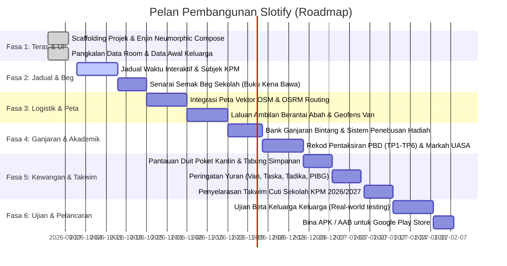

# 🗺️ Slotify — Product Development Roadmap

> **Target Release:** Q4 2026 – Q1 2027  
> **Platform:** Android Native (Jetpack Compose)  
> **Current Version:** `1.0.0-alpha01`

---

---

## 📌 Huraian Fasa Pembangunan

### 🔹 Fasa 1: Asas Teras & Seni Bina UI Neumorphic (SIAP ✅)
- [x] Inisialisasi projek Android Native dengan Kotlin 2.0 & Jetpack Compose BOM.
- [x] Reka cipta modifier Neumorphic (`NeumorphicModifier.kt`) dengan fizik bayang berkembar.
- [x] Skema pangkalan data Room (`StudentEntity`, `SchoolSessionEntity`, `TimetableSlotEntity`, `LocationNodeEntity`).
- [x] Seeder data sebenar keluarga (Adam, Aisyah, Danial).

### 🔹 Fasa 2: Pengurusan Jadual & Pembantu Beg Sekolah (SIAP ✅)
- [x] Paparan jadual penuh Isnin hingga Jumaat dengan penapis hari dan sesi.
- [x] Logik pertukaran sesi automatik Tahun 4 vs Tahun 5 (Pagi/Petang).
- [x] Ciri pintar "Buku Kena Bawa" berpandukan jadual hari esok berserta butang ganjaran `+5 ⭐`.
- [x] Panduan baju seragam harian (Isnin: Rasmi, Selasa: Sukan, Rabu: Koku, Khamis: Batik, Jumaat: Baju Melayu) dan sistem notifikasi berjadual.

### 🔹 Fasa 3: Logistik, Peta OpenStreetMap & Pengesanan Van (SIAP ✅)
- [x] Integrasi paparan peta OpenStreetMap (OSMDroid / MapLibre Native).
- [x] Pengiraan laluan berantai petang Abah (`Pejabat ➔ Tadika Danial ➔ Taska Aisyah ➔ Rumah`) berserta ETA masa pemanduan dan paparan garis jalan sebenar (GeoJSON).
- [x] Paparan status geofens Van Sekolah A dan Van Sekolah B serta amaran radar jarak dekat.

### 🔹 Fasa 4: Bank Ganjaran Bintang & Pentaksiran Akademik (SIAP ✅)
- [x] Pengumpulan syiling bintang secara automatik bila siap tugasan dan penilaian cemerlang.
- [x] Katalog penebusan hadiah dengan pengesahan PIN ibu bapa (SHA-256 + 3 Percubaan).
- [x] Modul rekod markah dan laporan PBD (Tahap Penguasaan TP1-TP6) berasaskan standard KPM.
- [x] Borang kerja rumah dengan fungsi tangkapan kamera bukti lembaran kerja (`AddHomeworkTaskDialog`).

### 🔹 Fasa 5: Pengurusan Duit Poket, Yuran & Takwim KPM (SIAP ✅)
- [x] Rekod belanja kantin harian & simpanan baki ke Tabung Maya dengan insentif +10 ⭐ Bintang.
- [x] Pusat pengurusan yuran bulanan (Van A, Taska, Tadika, PIBG) dengan status bayaran & dialog penambahan yuran.
- [x] Sinkronisasi kalendar takwim cuti sekolah KPM 2026/2027 (Kumpulan B - Selangor) dengan paparan dialog penuh & banner status sesi di dashboard.

### 🔹 Fasa 6: Ujian Beta & Pelancaran (Akan Datang ⚪)
- [ ] Pemasangan APK terus ke telefon bimbit Keluarga untuk ujian lapangan harian.
- [ ] Penambahbaikan berdasarkan pengalaman penggunaan sebenar.
- [ ] Pembungkusan AAB ditandatangani (*Signed Release AAB*) untuk Google Play Store.
